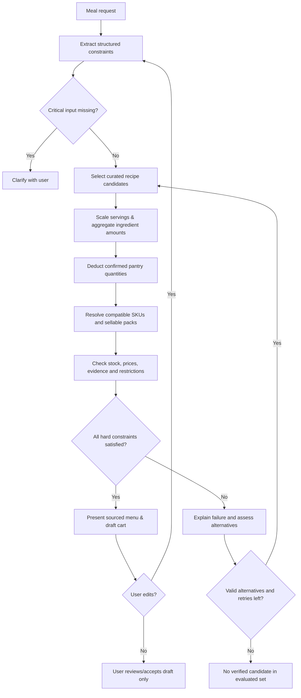

# UC-01 — Meal Request to Verified Grocery Cart (Design)

**Status:** PROPOSED / AWAITING PRODUCT SIGN-OFF  
**Owner:** MealMate product & engineering  
**Tracking:** [Issue #2](https://github.com/hungtvb/mealmate/issues/2)  
**Date:** 2026-11-04

This is the **canonical business/workflow design** for UC-01. [docs/UC-01.md](../../UC-01.md) is the short entry point; [docs/DATA_CONTRACT.md](../../DATA_CONTRACT.md) owns detailed field semantics and deterministic verification. No app code or external ShopMate source may be imported based solely on this draft.

## 1. Intent and why

A household shopper describes one **home-cooked meal**, diners, a grocery budget, dislikes, pantry items and relevant dietary restrictions. MealMate should return a plausible menu and a **buyable draft grocery cart** with traced recipe quantities, product pack counts, current price and stock evidence. The customer can revise the proposal before approving a cart. The application must not place an order or charge payment in UC-01.

**Success is not a fluent response; it is a verifiable proposal.** Failure means a confident but inaccurate cart, an unverified allergen claim, missing quantities, fabricated SKU or unintended checkout.

### Assumptions / not yet approved
- One simulated grocery store with an internally consistent catalog, price and inventory snapshot.
- Currency VND. A supplied budget caps the **subtotal of sellable packs in the cart**, before tax, shipping, discounts or vouchers. The UI explicitly labels exclusions.
- The meal is shared by all diners unless user requests otherwise. Shared dishes respect the union of explicit constraints; individual meal customization is deferred.
- Recipes and products are curated fixtures at first. No live retailer integrations, clinical diet planning or checkout.

## 2. Product approach comparison

| Approach | Pros | Risks / limitation | Status |
| --- | --- | --- | --- |
| A. LLM invents menu and ingredient list, then attempts SKU lookup | Highly flexible wording | Unbounded ingredient amounts; poor reproducibility; easier to hallucinate | Not recommended |
| **B. Recipe-first planning with structured recipes, then deterministic SKU/cart verification** | Traceable quantities, clear test oracle, easier constraints | Limited by coverage of recipe dataset | **Recommended; awaiting review** |
| C. SKU-first catalog optimizer generates recipes from available products | Strong stock awareness | Complicated recipe generation/quality; larger optimization surface | Deferred |

**Proposed rule:** The LLM can interpret intent, pick among valid recipes, explain or suggest alternatives. It cannot create a recipe quantity or product fact without structured source evidence. A recipe is eligible only when its complete ingredient list includes sauces, seasoning and processed components where available; incomplete declarations must not be treated as allergen-free.

## 3. Actor, scope and interaction

Primary actor: a household shopper. Optional: a supermarket operator supplies curated recipes and catalog. A staff admin interface is **out of scope**.

Sample request: “Bữa tối 4 người, tối đa 300.000đ; không cay, một người dị ứng tôm; nhà có 200 g gạo.”

Expected result:
- Menu with dish names, serving counts and explicit recipe versions.
- Aggregated ingredient list showing *required*, *already available*, *to buy*.
- SKU/package quantities and verified subtotal with item-level provenance.
- Dietary warnings or **REVIEW_REQUIRED** if suitability cannot be established.
- A draft cart that cannot be submitted/paid without a separate explicit action.

Follow-up such as “đổi món thịt thành cá, giữ nguyên ngân sách” must preserve diners, allergy and dislike constraints and recompute affected quantities and SKU pricing.

## 4. End-to-end flow

**Bound the retries**: attempt up to three alternate menus per request (proposed limit; tune later). No silent loop or mutation of inventory. Data issues produce an explicit conflict, not optimistic assumptions.

## 5. Data contracts (logical, not DB tables yet)

Logical overview below; **[DATA_CONTRACT.md](../../DATA_CONTRACT.md) is authoritative** for field meanings, evidence, snapshot validity, verification and review statuses. Exact Python/JSON schemas remain deferred to the implementation plan.

| Contract | Required fields | Invariants |
| --- | --- | --- |
| `MealRequest` | `request_id`, `conversation_revision`, `diners`, `meal_type`, `budget_vnd`, `dislikes[]`, `allergens[]`, `dietary_restrictions[]`, `pantry[]` | Allergens are canonical IDs per diner, combined for shared dishes. Each pantry item has stable `pantry_item_id`, quantity and independent food evidence. |
| `Recipe` | `recipe_id`, `version`, `title`, `base_servings`, `ingredients[]`, `source_ref`, `data_completeness` | Recipe components have version-scoped `component_id`; ingredient/seasoning completeness required. |
| `PlannedDish` | `recipe_id`, `recipe_version`, `target_servings`, `serving_role`, `portion_rationale` | Scaling uses **explicit target servings per selected dish**, not automatically `diners` for every recipe. Each dish declares its intended contribution to the meal; multi-dish portion policy requires review. |
| `Ingredient` | `ingredient_id`, `canonical_name`, `aliases[]`, `measurement_dimension`, `food_form`, `approved_conversion_refs[]` | Conversions allowed only within compatible dimensions and food forms, or via an explicit sourced factor. |
| `ProductSKU` | `sku`, `ingredient_id`, `food_form`, `pack_quantity`, `pack_unit`, `price_vnd_per_pack`, `stock_packs`, `catalog_snapshot_id`, `food_evidence_ref` | Must match recipe demand by canonical ingredient ID, compatible food form and units; one SKU satisfies one ingredient demand in UC-01. |
| `FoodEvidence` | `evidence_id`, `subject_type`, typed `subject_ref`, `ingredient_statement`, per-`allergen_id` `allergen_assessments[]`, `source_ref`, `evidence_revision`, `assessed_at` | Per-allergen ingredient presence and cross-contact require independent evidence; absent/missing assessment stays UNKNOWN, never a medical-safety certification. |
| `CatalogSnapshot` | `snapshot_id`, `store_id`, `observed_at`, `price_valid_until`, `stock_valid_until`, `source_ref`, `source_revision` | Facts share one store snapshot and pass `observed_at <= as_of < valid_until`; stale/missing validity becomes `DATA_UNAVAILABLE`. |
| `CartLine` | `ingredient_id`, `required_qty`, `confirmed_pantry_qty`, `buy_qty`, `sku`, `packs`, `price_per_pack_vnd`, `line_total_vnd`, `source_refs[]` | `buy_qty = max(0, required_qty - confirmed_pantry_qty)`; pack quantity covers buy_qty |
| `DraftCart` | `cart_id`, `revision`, `request_revision`, `planned_dishes[]`, `lines[]`, `subtotal_vnd`, `budget_vnd`, `snapshot_id`, `verified_at`, `verification_status`, `problems[]`, `user_review_state`, `accepted_at?` | Verification and explicit user acceptance are distinct. `ACCEPTED` requires a currently verified draft and is not an order. |

**Data provenance:** recipe `source_ref`, ingredient mapping, product label record and catalog snapshot must be inspectable, not merely a natural-language citation added by an LLM.

**Food-form caveat:** 500 g cooked chicken is not interchangeable with 500 g raw chicken. A transformation requires an explicit yield/conversion factor. Otherwise mark unresolved rather than guessing.

**Health/privacy:** Do not collect disease diagnoses unless necessary; accept user-specified restrictions such as “ít muối” with an explicit meaning/threshold if quantitative filtering is expected. Do not persist personal health or allergy details beyond the active session by default.

## 6. Business rules and deterministic verification

1. Validate `diners > 0`, budget format/currency, and required serving information before computing.
2. Set each `PlannedDish.target_servings` based on its role in the full menu and recipe yield, then scale its ingredients by `target_servings / base_servings` using decimal/rational arithmetic. **Do not assume four diners require four full servings of every dish.** Record the selected per-dish portion plan so a reviewer can check coverage; do not round intermediate quantities early.
3. Aggregate only compatible `ingredient_id + measurement_dimension + food_form`; do not combine units or preparation forms by name alone.
4. Subtract pantry quantities **only if confirmed**. “Có gạo” without amount remains unresolved; it cannot silently zero out rice requirements.
5. For a single-SKU candidate: `packs = ceil(buy_qty / pack_quantity)` after compatible unit conversion. Example **test fixture**: 600 g needed, 500 g packs at 75,000 VND, 2 packs required → 150,000 VND. With 200 g confirmed on hand, 1 pack → 75,000 VND.
6. For MVP, choose **one verified SKU per ingredient** from a bounded set; select the lowest **total purchasable package cost** that covers the required quantity and meets stock/ingredient constraints. **If one SKU maps to multiple different canonical ingredient demands, reject that combination for UC-01 rather than charge or allocate its packs twice.** This is not a guarantee of global optimality across multi-SKU combinations.
7. Price is computed only by trusted `sum(packs × price_vnd_per_pack)`; insufficient stock, missing prices or incompatible units are hard blockers. Stock and price facts must be from one compatible store `CatalogSnapshot`, with explicit `price_valid_until` and `stock_valid_until`. Validate at `as_of` as described in [DATA_CONTRACT.md](../../DATA_CONTRACT.md); no universal freshness TTL is assumed.
8. Budget is a hard cap on proposed cart subtotal. If no feasible combination, say why and offer a verified cheaper menu or a request to revise budget. Do not hide the cost of unused remainder of packs.
9. Allergens: apply the union of declared allergies across all diners sharing the meal; check every recipe ingredient (including sauces/seasonings), each selected SKU's label/cross-contact evidence **and any pantry ingredients relied on for that recipe**. Known incompatible ingredients are a hard rejection. Unknown/uncertain evidence returns `REVIEW_REQUIRED` and **never an allergen-safe claim**. A draft with unresolved allergy evidence cannot become `VERIFIED` or be automatically approved.
10. Clinical context: no disease-based diet inference. Only explicit restrictions are enforceable; if insufficiently specified, ask or warn, not provide medical guarantees.
11. No missing-data fallbacks that reinterpret unknown stock as zero, unknown price as free, or unknown allergen status as safe.
12. After any user change, invalidate prior verification and acceptance, recalculate all affected quantities, prices and checks. A draft cart reflects its data snapshot and must be rechecked before any future checkout integration. UC-01's accepted draft is **never** an order.

### Verification statuses
- `VERIFIED`: quantity, pack, budget, stock, price and required evidence checks satisfied for the specified snapshot. **Not a guarantee of medical allergen safety**.
- `REVIEW_REQUIRED`: further trustworthy ingredient/allergen evidence or clarification required; user acknowledgment alone does not grant verified or accepted status.
- `INFEASIBLE`: one or more hard constraints cannot be satisfied with available data/candidates.
- `DATA_UNAVAILABLE`: authoritative data missing, stale or inconsistent.

### Reporting multiple constraint failures

A cart/result must retain **all** observed blockers as structured `problems[]` (reason code, affected recipe/ingredient/SKU, evidence reference and suggested next action), even when one primary status is shown. The primary status is a summary **not** a substitute for individual reasons:
- Known unsafe/forbidden ingredients and known infeasible hard constraints: reject the candidate as `INFEASIBLE`.
- Missing authoritative facts needed to decide safety, price, stock or conversions: `DATA_UNAVAILABLE` for the affected candidate, except unresolved allergen/cross-contact evidence is explicitly `REVIEW_REQUIRED`.
- A candidate is `VERIFIED` **only if no unresolved blockers remain**; customer review of a warning is not evidence that the product is safe.
- If reasons overlap, show the complete list and require a fresh candidate evaluation rather than infer success from a single status. Do not use a failure of one candidate to claim that *no* possible menu is feasible. Exhausting the bounded search returns `NO_VERIFIED_CANDIDATE_IN_EVALUATED_SET`, a **conversation outcome**, not a verified statement that every menu is infeasible.

## 7. Boundaries (why agentic, why deterministic)

| Responsibility | Proposed executor |
| --- | --- |
| Interpret conversation and preserve explicit constraints | LLM with structured extraction + validation |
| Plan a menu from valid candidates | Bounded planner (LLM may rank/justify, never invent recipe facts) |
| Search recipe knowledge | Structured recipe records; RAG only for unstructured explanations with cited sources |
| Scale recipe, normalize units and deduct pantry | Deterministic recipe/ingredient resolver |
| Read SKU, stock, label and price | Catalog/inventory/price service (possibly MCP adapter; transport is a separate decision) |
| Select sellable packs and budget-check | Deterministic cart builder / verifier |
| Present alternatives, caveats and revise | Orchestrated dialog |
| Review and approve draft cart | Customer explicit action; **not payment** |

Use one orchestration flow initially, not a predeclared army of agents. Superpowers applies to development workflow, not runtime architecture.

## 8. Acceptance scenarios / test oracles

| ID | Input | Required observed behavior |
| --- | --- | --- |
| AC01 | Fixed positive fixture §11: 4 diners, 140,000 VND, snapshot S-FG-001 | Must be `VERIFIED`, 5 purchased lines/6 packages, exactly 116,000 VND; unconditional `INFEASIBLE` **fails**. |
| AC02 | Avoid spicy food | No verified menu with known spicy dish; ambiguous seasoning clarified |
| AC03 | One diner allergic to shrimp | Reject known shrimp-containing recipes/SKUs; unknown label/cross-contact → REVIEW_REQUIRED, no safety assurance |
| AC04 | Have 200 g rice and unspecified oil | Deduct only 200 g rice; clarify or retain oil quantity, never assume all oil on hand |
| AC05 | Missing price / stale stock | DATA_UNAVAILABLE with no invented subtotal or availability; fresh alternatives reverified |
| AC06 | Need 600 g, 500 g pack at 75k | Two packages, 150k before pantry; insufficient stock blocks that SKU |
| AC07 | “Đổi món thịt sang cá, giữ ngân sách” | Replace dish, recompute from sources, retain all other active constraints |
| AC08 | User accepts currently verified draft | Change `user_review_state` to `ACCEPTED` only when `verification_status=VERIFIED`; cannot create order or payment. Unknown allergy evidence blocks acceptance. |
| AC09 | Fixed 140,000 VND fixture repriced in new snapshot S-FG-002 (G-TOM500 = 50,000 VND) | **This candidate only**: `INFEASIBLE` with `BUDGET_EXCEEDED` (148,000 VND); do **not** assert that all other menu candidates are impossible or search is exhausted. |
| AC10 | Price/stock changes after draft | Snapshot mismatch → revalidation before any future confirmed order |
| AC11 | Recipe uses cooked vs raw form without yield data | Cannot assert quantity match; ask/mark data unavailable |
| AC12 | Same ingredient in two recipes | Aggregate once and apply package rounding **after** aggregation |
| AC13 | Four diners share a main and two side dishes | Record each dish's planned serving target; no blind multiplication of full-meal portions across all dishes |
| AC14 | One combo SKU appears eligible for two distinct ingredient demands | Reject unsupported cross-ingredient allocation; never count one package twice or double-charge stock |
| AC15 | Declared allergy; processed seasoning or pantry item has unknown evidence | Preserve `REVIEW_REQUIRED`; never treat recipe or pantry as automatically safe |
| AC16 | Stale stock and incompatible ingredient in the same candidate | Preserve both reason codes with evidence; never return a verified cart |
| AC17 | Two allergens SHRIMP + PEANUT: tomato SKU has SHRIMP assessed absent, PEANUT cross-contact UNKNOWN | Return REVIEW_REQUIRED for PEANUT; SHRIMP evidence cannot clear PEANUT; no VERIFIED or ACCEPTED. |
| AC18 | Two pantry rice packages and recipe R02 updated from v1 to v2 | Distinct pantry_item_id and version-scoped recipe component evidence; no evidence reused across mismatched identities. |
| AC19 | Verified at 06:10Z, customer accepts after stock expiry at 06:31Z | Atomic acceptance check rejects stale VERIFIED and requires refreshed re-verification and renewed user confirmation. |
| AC20 | User edits budget/recipe to request_revision=2 and clicks old draft revision=1 | Compare-and-swap fails, old acceptance blocked and verification invalidated. |
| AC21 | Allergy declared and a pantry item's label/evidence unknown | Priced provisional SKU list permitted with warnings; whole meal cannot be VERIFIED/ACCEPTED; customer acknowledgment is not safety clearance. |
| AC22 | No allergens declared with full current catalog and recipe data | Economic/portion/cart checks can be VERIFIED, but UI states “no allergens assessed” and does not promise allergy safety. |
| AC23 | Orchestrator receives *injected* candidate outcomes C01=`INFEASIBLE/BUDGET_EXCEEDED`, C02=`INFEASIBLE/SKU_OUT_OF_STOCK`, C03=`REVIEW_REQUIRED/UNKNOWN_CROSS_CONTACT` with candidate limit 3 | Evaluate exactly these 3 candidate IDs; no `VERIFIED` candidate, so conversation outcome is `NO_VERIFIED_CANDIDATE_IN_EVALUATED_SET`. This is an **orchestration-only test** (stubbed evaluator results), not a claim that every possible menu is infeasible. |

### Demonstration set (synthetic; not production evidence)
Start from the **pinned six-SKU fixture in §11**; grow beyond it only to cover a named acceptance scenario. For allergy tests use per-allergen evidence; the no-allergy golden case does not claim medical safety. Include positive, impossible-budget, missing-label and stale-stock cases. This is a **proposed test design**, not data already created.

### Evidence gate
Before approving UC-01 implementation, require: defined data contracts, fixed test oracles, a deterministically reproducible cart example, negative allergy cases, and clear criteria for live LLM evaluation. Later classify test evidence as unit, integration, E2E or human review. No fabricated PASS rates.

## 9. ShopMate selective reuse decision

| Module family | Proposed disposition | Proof required before import |
| --- | --- | --- |
| LangGraph workflow/checkpoint patterns | **Study / possibly reuse** | Clear state and resume semantics, bounded retry and tests |
| MCP transport/client utilities | **Evaluate for reuse** | Proper error handling, timeouts, actual protocol calls |
| Recipe/RAG loaders | **Adapt patterns only** | Corpus type, metadata/provenance and retrieval correctness |
| FastAPI/UI/test helpers | **Evaluate separately** | No hardcoded ShopMate retail assumptions; license |
| Refund/HITL, verifier, security fallbacks | **Do not reuse as-is** | Previously observed correctness concerns require new boundaries |
| A2A and Deep Agents | **Defer** | Concrete multi-service/long-horizon need and tested benefit |

The ShopMate archive is a reference, not an approved source dependency. Verify ownership/license and permission before copying any source.

## 10. Risks, anti-goals and review decisions

- **Coverage risk:** curated recipes may not cover diverse cuisines. Prefer honest "no suitable recipe" to hallucinated availability.
- **Price risk:** price/stock are time-sensitive; retain source snapshot and recheck.
- **Allergy risk:** absence of a printed "may contain" warning is not a guarantee. Present uncertainty without claiming suitability.
- **Optimization risk:** single-SKU-per-ingredient heuristic may be more expensive than combined packs; report subtotal as observed, do not call it globally optimal.
- **Interaction risk:** too many clarification questions prevent task completion; ask only when required for safety/correctness and otherwise provide clearly marked options.

### Decisions requested at review
1. Confirm whether the hard budget should cover **actual purchased packages** (recommended) or ingredient consumption cost. Current brief suggests purchased packages.
2. Confirm single-store + one shared meal for all diners as the first slice.
3. Confirm unknown allergy evidence blocks `VERIFIED` but can be shown in a clearly marked `REVIEW_REQUIRED` proposal for manual inspection.
4. Confirm recipe-first approach B and explicitly bounded alternatives.
5. Confirm the default shared-meal portion policy (main + side dishes) and that recipes/condiments/pantry inputs must each be assessed for declared allergies.
6. Confirm one-store `CatalogSnapshot` with explicit fact expiry and separate, non-overridable review for unresolved allergen evidence.

## 11. Golden fixture: positive deterministic test vector (synthetic)

**Fixture ID:** F-UC01-POS. This is fictional test data, not a live catalog, recipe validation or medical assurance. **Expected:** VERIFIED, five purchased SKU lines / six packages, 116,000 VND and no observed constraint blockers. An implementation returning INFEASIBLE always fails AC01.

**Request:** `request_id=REQ-001`, `conversation_revision=1`, four diners, budget 140,000 VND, dinner, `allergens=[]`, `dislikes=[]` and no dietary restrictions. Pantry: `P01` 500 g dry rice, `P02` 100 g tomatoes, `P03` 3000 ml water, with quantities confirmed. These are user statements, not independent health assessments.

**Confirmed pantry identities** (stable within `REQ-001`; `food_form` means the form *before cooking*):

| pantry_item_id | ingredient_id | food_form | Confirmed quantity | FoodEvidence |
| --- | --- | --- | --- | --- |
| P01 | rice | dry_uncooked | 500 g | FE-P01 |
| P02 | tomato | fresh_raw | 100 g | FE-P02 |
| P03 | water | potable_liquid | 3000 ml | FE-P03 |

**Snapshot:** `store_id=FG-01`, `snapshot_id=S-FG-001`, `source_ref=fixture:grocery/FG-01`, `source_revision=stock-price-v1`, `observed_at=2026-11-04T06:00:00Z`, `price_valid_until=2026-11-04T08:00:00Z`, `stock_valid_until=2026-11-04T06:30:00Z`, `as_of=2026-11-04T06:10:00Z`. All sellable SKU rows below use this snapshot, its source revision and integer VND prices.

**Recipes:** All four are `version=v1`, `base_servings=4`, `target_servings=4`, `data_completeness=COMPLETE`, with `source_ref=fixture:recipe/<recipe_id>@v1`; each `PlannedDish` has `portion_rationale=shared household dish`. Each listed ingredient is complete for this narrowly curated sample: there are **no unlisted seasonings, sauces or cooking inputs**. Water is included explicitly for cooking and supplied by the pantry.

| Recipe | Role | Complete RecipeIngredient lines: `component_id → ingredient_id / food_form / quantity` |
| --- | --- | --- |
| R01 Cơm trắng | side | c01 → rice / dry_uncooked / 400 g; c02 → water / potable_liquid / 600 ml |
| R02 Trứng chiên cà chua | main | c01 → eggs / raw_in_shell / 4 pcs; c02 → tomato / fresh_raw / 300 g; c03 → oil / edible_liquid / 20 ml |
| R03 Canh đậu phụ cà chua | side | c01 → tomato / fresh_raw / 200 g; c02 → tofu / fresh_as_sold / 400 g; c03 → water / potable_liquid / 800 ml |
| R04 Rau cải luộc | side | c01 → greens / fresh_raw / 400 g; c02 → water / potable_liquid / 800 ml |

**Store catalog:** Every listed SKU has one canonical ingredient mapping and `food_evidence_ref=FE-<sku>`. Stock is measured in sellable packages; snapshots and sources are as defined above. The deterministic join is **(ingredient_id, food_form, compatible unit)**, not the name displayed to shoppers. Water (`water`, `potable_liquid`) is fulfilled entirely from pantry and has **no SKU mapping**; if that pantry supply were insufficient, the cart could not be marked verified without a compatible source.

| SKU | ingredient_id | food_form | Sellable pack | Price (VND) | Stock packs |
| --- | --- | --- | --- | ---: | ---: |
| G-RICE1000 | rice | dry_uncooked | 1000 g | 26,000 | 5 |
| G-EGG10 | eggs | raw_in_shell | 10 pcs | 30,000 | 3 |
| G-TOM500 | tomato | fresh_raw | 500 g | 18,000 | 5 |
| G-OIL500 | oil | edible_liquid | 500 ml | 28,000 | 3 |
| G-TOFU200 | tofu | fresh_as_sold | 200 g | 12,000 | 5 |
| G-GREEN500 | greens | fresh_raw | 500 g | 16,000 | 3 |

**Complete FoodEvidence test records:** each row below is **one** evidence record (19 total). In addition to the fields shown, each record has `assessed_at=2026-11-04T06:00:00Z`, `allergen_assessments=[]` (because **no allergens were declared**), and an explicit `evidence_revision`: `recipe-v1` for recipe components, `request-rev1` for pantry, `label-v1` for SKU. Empty per-allergen assessments **never mean** “assessed allergen-free”; a future allergy-constrained test must provide individual assessments. Pantry sources are user assertions, not trusted supplier labels. The test records are fixtures, not actual evidence from real producers.

| evidence_id | subject_type | subject_ref | ingredient_statement | source_ref |
| --- | --- | --- | --- | --- |
| `FE-R01-c01` | `recipe_component` | `(R01,v1,c01)` | `dry rice` | `fixture:recipe/R01@v1` |
| `FE-R01-c02` | `recipe_component` | `(R01,v1,c02)` | `water` | `fixture:recipe/R01@v1` |
| `FE-R02-c01` | `recipe_component` | `(R02,v1,c01)` | `eggs` | `fixture:recipe/R02@v1` |
| `FE-R02-c02` | `recipe_component` | `(R02,v1,c02)` | `tomatoes` | `fixture:recipe/R02@v1` |
| `FE-R02-c03` | `recipe_component` | `(R02,v1,c03)` | `cooking oil` | `fixture:recipe/R02@v1` |
| `FE-R03-c01` | `recipe_component` | `(R03,v1,c01)` | `tomatoes` | `fixture:recipe/R03@v1` |
| `FE-R03-c02` | `recipe_component` | `(R03,v1,c02)` | `tofu` | `fixture:recipe/R03@v1` |
| `FE-R03-c03` | `recipe_component` | `(R03,v1,c03)` | `water` | `fixture:recipe/R03@v1` |
| `FE-R04-c01` | `recipe_component` | `(R04,v1,c01)` | `greens` | `fixture:recipe/R04@v1` |
| `FE-R04-c02` | `recipe_component` | `(R04,v1,c02)` | `water` | `fixture:recipe/R04@v1` |
| `FE-P01` | `pantry_item` | `(REQ-001,P01)` | `dry rice` | `fixture:request/REQ-001@rev1` |
| `FE-P02` | `pantry_item` | `(REQ-001,P02)` | `tomatoes` | `fixture:request/REQ-001@rev1` |
| `FE-P03` | `pantry_item` | `(REQ-001,P03)` | `water` | `fixture:request/REQ-001@rev1` |
| `FE-G-RICE1000` | `sku` | `(FG-01,G-RICE1000,S-FG-001)` | `dry rice` | `fixture:label/G-RICE1000@v1` |
| `FE-G-EGG10` | `sku` | `(FG-01,G-EGG10,S-FG-001)` | `eggs` | `fixture:label/G-EGG10@v1` |
| `FE-G-TOM500` | `sku` | `(FG-01,G-TOM500,S-FG-001)` | `tomatoes` | `fixture:label/G-TOM500@v1` |
| `FE-G-OIL500` | `sku` | `(FG-01,G-OIL500,S-FG-001)` | `cooking oil` | `fixture:label/G-OIL500@v1` |
| `FE-G-TOFU200` | `sku` | `(FG-01,G-TOFU200,S-FG-001)` | `tofu` | `fixture:label/G-TOFU200@v1` |
| `FE-G-GREEN500` | `sku` | `(FG-01,G-GREEN500,S-FG-001)` | `greens` | `fixture:label/G-GREEN500@v1` |

**Expected deterministic outcome:** `verification_status=VERIFIED`, `user_review_state=DRAFT`, `problems=[]`, `subtotal_vnd=116000`. Exactly five purchased SKU lines with packs `G-EGG10=1`, `G-TOM500=1`, `G-OIL500=1`, `G-TOFU200=2`, `G-GREEN500=1`. Rice and water are wholly fulfilled by pantry, no purchase line. This status verifies the specified request's **non-allergy** constraints at `as_of`; display **“No allergens were assessed; do not infer allergen safety.”**

| Ingredient | Total required | Confirmed pantry | To buy | SKU pack count | Charged cost |
| --- | ---: | ---: | ---: | ---: | ---: |
| Dry rice | 400 g | 500 g | 0 g | 0 | 0 VND |
| Eggs | 4 pcs | 0 | 4 pcs | 1 × G-EGG10 | 30,000 VND |
| Tomatoes | 500 g | 100 g | 400 g | 1 × G-TOM500 | 18,000 VND |
| Cooking oil | 20 mL | 0 | 20 mL | 1 × G-OIL500 | 28,000 VND |
| Tofu | 400 g | 0 | 400 g | 2 × G-TOFU200 | 24,000 VND |
| Greens | 400 g | 0 | 400 g | 1 × G-GREEN500 | 16,000 VND |
| Water | 2200 ml | 3000 ml | 0 ml | 0 | 0 VND |
| **Total** | | | | **6 packages** | **116,000 VND** |

This example checks a key invariant: tomatoes used in two recipes are **aggregated before** subtracting pantry supply and rounding to packs. The user is charged for purchasable packs, including unused remainder; food already covered by the pantry does not produce a cart line.

**Controlled negative variations:**
- If G-TOFU200 stock falls from 5 to **1**, the two-pack tofu line cannot be marked verified. Try a separately evidenced available alternative; otherwise surface `INFEASIBLE`.
- **AC09 / candidate-level only:** Use a *new* compatible snapshot `S-FG-002` at `observed_at=2026-11-04T06:11:00Z`, `source_revision=stock-price-v2`, with the same validity endpoints as `S-FG-001` and evaluate at `as_of=2026-11-04T06:12:00Z`; set G-TOM500 price from **18,000** to **50,000 VND** while all other prices/stock remain unchanged. The unchanged basket costs **148,000 VND** (over 140,000), so **this candidate** is `INFEASIBLE` with `BUDGET_EXCEEDED`. This does **not** prove the whole menu search is exhausted; another menu may still meet budget.
- **Two-allergen fixture (AC17):** Declare `SHRIMP` and `PEANUT`. For all otherwise used recipe/pantry/SKU subjects, provide synthetic per-allergen `(ingredient_presence=ABSENT, cross_contact_status=ASSESSED_ABSENT)` records with source/scope **except** `FE-G-TOM500`, which has `SHRIMP=(ABSENT, ASSESSED_ABSENT)` but `PEANUT=(ABSENT, UNKNOWN)`. Result: `REVIEW_REQUIRED` for PEANUT, never VERIFIED; these mock records test logic, not real-world safety.
- If `as_of` is at or beyond the snapshot's `stock_valid_until` or `price_valid_until`, return `DATA_UNAVAILABLE` until authoritative refresh. Snapshot validity is a documented data contract, not an invented global TTL.
- **Identity (AC18):** Add pantry rice package `P04` alongside `P01` and revise tomato component `(R02,v1,c02)` to `(R02,v2,c02)`. Each item must have its own evidence record; v1 evidence cannot authorize v2.
- **Acceptance race (AC19–20):** After verification at 06:10Z, an attempted acceptance at 06:31Z fails on expired stock; changing the request to revision 2 also rejects a revision 1 acceptance. No stale cart transitions to `ACCEPTED`.
- **Pantry boundary (AC21):** With declared allergy and missing label/evidence on `P01`, the priced list can be displayed provisionally, but the whole meal remains REVIEW_REQUIRED until the ingredient is replaced/removed or reliable evidence is provided; acknowledgment cannot resolve it.

**Separate bounded-search oracle (AC23):** Use *stubbed candidate evaluator outputs* for exactly three candidate IDs, `C01 → INFEASIBLE/BUDGET_EXCEEDED`, `C02 → INFEASIBLE/SKU_OUT_OF_STOCK`, `C03 → REVIEW_REQUIRED/UNKNOWN_CROSS_CONTACT`, with candidate limit 3 and no other candidates enumerated. Assert that the planner evaluates each once, does not invent a fourth candidate and reports `NO_VERIFIED_CANDIDATE_IN_EVALUATED_SET` at the **conversation** level. These are not full recipes and cannot replace AC01's cart-calculation fixture.

### Minimum fixture review gate

Before constructing any larger synthetic dataset, validate this exact worked example and its four negative variations on paper. Additional recipe/SKU coverage should be driven by uncovered acceptance scenarios, not by arbitrary row counts.

**Sign-off gate:** This spec and its assumptions require user review. Once approved, create an implementation plan via Superpowers; no code, app scaffold or ShopMate import in this PR.
