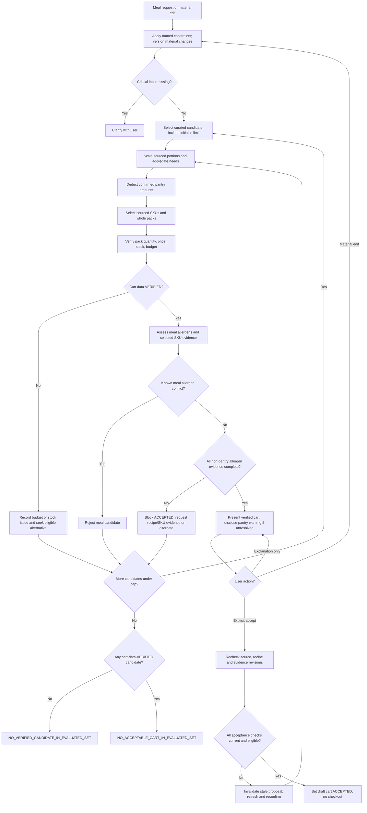

# UC-01 — Meal Request to Verified Grocery Cart (Design)

**Status:** PROPOSED / AWAITING OVERALL PRODUCT SIGN-OFF — pantry **Option B**, purchased-SKU **Option A**, whole-pack budget **Option A**, automatic portion proposal **Option A** and proactive budget/stock fallback **Option A** approved  
**Owner:** MealMate product & engineering  
**Tracking:** [Issue #2](https://github.com/hungtvb/mealmate/issues/2)  
**Date:** 2026-11-04

This is the **canonical business/workflow design** for UC-01. [docs/UC-01.md](../../UC-01.md) is the short entry point; [docs/DATA_CONTRACT.md](../../DATA_CONTRACT.md) owns detailed field semantics and deterministic verification. No app code or external ShopMate source may be imported based solely on this draft.

## 1. Intent and why

A household shopper describes one **home-cooked meal**, diners, a grocery budget, dislikes, pantry items and relevant dietary restrictions. MealMate should return a plausible menu and a **buyable draft grocery cart** with traced recipe quantities, product pack counts, current price and stock evidence. The customer can revise the proposal before approving a cart. The application must not place an order or charge payment in UC-01.

**Success is not a fluent response; it is a verifiable proposal.** Failure means a confident but inaccurate cart, an unverified allergen claim, missing quantities, fabricated SKU or unintended checkout.

### Assumptions / not yet approved
- One simulated grocery store with an internally consistent catalog, price and inventory snapshot.
- **Approved budget Option A:** Currency VND. The hard budget compares the **subtotal of complete sellable packs purchased** (`Σ packs × price_vnd_per_pack`), not the amount of each ingredient consumed. The package remainder is paid for and should be visible. Tax, shipping, discounts and vouchers are outside the initial subtotal assumption, which must be visibly disclosed and remains a separate scope decision.
- The meal is shared by all diners unless user requests otherwise. Shared dishes respect the union of explicit constraints; individual meal customization is deferred.
- **Approved portion Option A:** MealMate proposes a balanced shared-meal serving plan from **curated recipe yields and serving-role guidance** for main/side/soup dishes. The shopper is not required to supply portion sizes before receiving a proposed cart; they can change any proposed dish servings later. Never ask the LLM to invent grams, recipe yields or quantities.
- Recipes and products are curated fixtures at first. No live retailer integrations, clinical diet planning or checkout.
- **Approved fallback Option A:** On `BUDGET_EXCEEDED` or `SKU_OUT_OF_STOCK`, proactively try another evidence-backed **SKU combination or curated recipe/menu** within the same hard constraints and `max_evaluated_candidates=3` total. Present the first eligible, reverified alternative for the shopper to choose; never raise the budget, weaken allergy/dietary restrictions or silently change an already accepted cart.

## 2. Product approach comparison

| Approach | Pros | Risks / limitation | Status |
| --- | --- | --- | --- |
| A. LLM invents menu and ingredient list, then attempts SKU lookup | Highly flexible wording | Unbounded ingredient amounts; poor reproducibility; easier to hallucinate | Not recommended |
| **B. Recipe-first planning with structured recipes, then deterministic SKU/cart verification** | Traceable quantities, clear test oracle, easier constraints | Limited by coverage of recipe dataset | **Recommended; awaiting review** |
| C. SKU-first catalog optimizer generates recipes from available products | Strong stock awareness | Complicated recipe generation/quality; larger optimization surface | Deferred |

**Proposed rule:** The LLM can interpret intent, pick among valid recipes, explain or suggest alternatives. It cannot create a recipe quantity or product fact without structured source evidence. A recipe is eligible only when its complete ingredient list includes sauces, seasoning and processed components where available; incomplete declarations must not be treated as allergen-free.

## 3. Actor, scope and interaction

Primary actor: a household shopper. Optional: a supermarket operator supplies curated recipes and catalog. A staff admin interface is **out of scope**.

Sample request: “Bữa tối 4 người, tối đa 300.000đ; không cay, một người dị ứng tôm; nhà có 200 g gạo.”

Expected result:
- Menu with dish names, serving counts and explicit recipe versions.
- Aggregated ingredient list showing *required*, *already available*, *to buy*.
- SKU/package quantities and verified subtotal with item-level provenance.
- Separate cart verification and meal-allergen warning statuses. Pantry uncertainty does not automatically prevent accepting a separately verified shopping cart (approved Option B).
- A draft cart that cannot be submitted/paid without a separate explicit action.

Follow-up such as “đổi món thịt thành cá, giữ nguyên ngân sách” must preserve diners, allergy and dislike constraints and recompute affected quantities and SKU pricing.

## 4. End-to-end flow

**Approved fallback Option A and candidate bound:** Proactively retry `BUDGET_EXCEEDED` and `SKU_OUT_OF_STOCK` cases using another sourced sellable SKU or curated dish/menu without asking permission before **searching**. `max_evaluated_candidates=3` **total**, including the first evaluated menu+SKU-cart proposal and at most two alternatives (whether SKU substitutions or menu changes). A different SKU selection for an otherwise identical menu is a **new evaluated candidate**; count it toward the same limit. Do not repeat the same candidate or silently exceed this cap. This proves only bounded search, not global infeasibility. On success, **present** the alternative and its reasons and newly verified subtotal/stock, requiring explicit shopper acceptance; do not mutate an already accepted cart or auto-checkout. On exhaustion, show the specific blockers and offer to let the shopper change the budget/menu/ingredient rather than automatically relax constraints. A changed meal request starts a fresh proposal; a read-only explanation does not mutate the request or reset the candidate budget. Candidate-level cart verification is distinct from purchased-SKU allergen **acceptability**: the former can pass while the latter blocks acceptance (approved SKU Option A). An unknown **pantry** allergen alone permits explicit acceptance with visible warning (approved pantry Option B). Confirmation always rechecks current evidence and catalog facts, without placing an order.

## 5. Data contracts (logical, not DB tables yet)

Logical overview below; **[DATA_CONTRACT.md](../../DATA_CONTRACT.md) is authoritative** for field meanings, evidence, snapshot validity, verification and review statuses. Exact Python/JSON schemas remain deferred to the implementation plan.

| Contract | Required fields | Invariants |
| --- | --- | --- |
| `MealRequest` | `request_id`, `conversation_revision`, `diners`, `meal_type`, `budget_vnd`, `dislikes[]`, `allergens[]`, `dietary_restrictions[]`, `pantry[]` | Allergens are canonical IDs per diner, combined for shared dishes. Each pantry item has stable `pantry_item_id`, quantity and independent food evidence. |
| `Recipe` | `recipe_id`, `version`, `title`, `base_servings`, `default_serving_role`, `ingredients[]`, `source_ref`, `data_completeness` | `base_servings` describes the **yield in the curated role**, such as side portions; source-backed role/yield is required before the planner proposes quantities. Ingredient and seasoning completeness is required. |
| `PlannedDish` | `recipe_id`, `recipe_version`, `target_servings`, `serving_role`, `portion_rationale` | **Approved portion Option A:** propose servings automatically from sourced recipe yield/role and complete meal composition. `target_servings` are reviewable and editable; deterministic scaling, never LLM-fabricated ingredients. |
| `Ingredient` | `ingredient_id`, `canonical_name`, `aliases[]`, `measurement_dimension`, `food_form`, `approved_conversion_refs[]` | Conversions allowed only within compatible dimensions and food forms, or via an explicit sourced factor. |
| `ProductSKU` | `sku`, `ingredient_id`, `food_form`, `pack_quantity`, `pack_unit`, `price_vnd_per_pack`, `stock_packs`, `catalog_snapshot_id`, `food_evidence_ref` | Must match recipe demand by canonical ingredient ID, compatible food form and units; one SKU satisfies one ingredient demand in UC-01. |
| `FoodEvidence` | `evidence_id`, `subject_type`, typed `subject_ref`, `ingredient_statement`, per-`allergen_id` `allergen_assessments[]`, `source_ref`, `evidence_revision`, `assessed_at` | Per-allergen ingredient presence and cross-contact require independent evidence; absent/missing assessment stays UNKNOWN, never a medical-safety certification. |
| `CatalogSnapshot` | `snapshot_id`, `store_id`, `observed_at`, `price_valid_until`, `stock_valid_until`, `source_ref`, `source_revision` | Facts share one store snapshot and pass `observed_at <= as_of < valid_until`; stale/missing validity becomes `DATA_UNAVAILABLE`. |
| `CartLine` | `ingredient_id`, `required_qty`, `confirmed_pantry_qty`, `buy_qty`, `sku`, `packs`, `price_per_pack_vnd`, `line_total_vnd`, `source_refs[]` | `buy_qty = max(0, required_qty - confirmed_pantry_qty)`; pack quantity covers buy_qty |
| `DraftCart` | `cart_id`, `revision`, `request_revision`, `planned_dishes[]`, `lines[]`, `subtotal_vnd`, `budget_vnd`, `snapshot_id`, `verified_at`, `verification_basis`, `cart_verification_status`, `meal_allergen_status`, `problems[]`, `user_review_state`, `accepted_at?` | `verification_basis` pins catalog, recipe and every selected FoodEvidence revision. Cart facts and meal-allergen checks remain separate; ACCEPTED is neither a medical-safety claim nor an order. |

**Data provenance:** recipe `source_ref`, ingredient mapping, product label record and catalog snapshot must be inspectable, not merely a natural-language citation added by an LLM.

**Food-form caveat:** 500 g cooked chicken is not interchangeable with 500 g raw chicken. A transformation requires an explicit yield/conversion factor. Otherwise mark unresolved rather than guessing.

**Health/privacy:** Do not collect disease diagnoses unless necessary; accept user-specified restrictions such as “ít muối” with an explicit meaning/threshold if quantitative filtering is expected. Do not persist personal health or allergy details beyond the active session by default.

## 6. Business rules and deterministic verification

1. Validate `diners > 0`, budget format/currency, and required serving information before computing.
2. **Approved portion Option A:** Auto-propose each `PlannedDish.target_servings` from the number of diners, curated recipe `base_servings`, the recipe's reviewed main/side/soup serving role and the meal composition. A side-dish serving is a **side portion**, not a complete meal; do **not** blindly multiply every full-meal recipe by the diner count. The LLM may choose/rank sourced recipes and approved portion options, but the quantities come only from recipe records and `target_servings / base_servings` scaling. Record `portion_rationale` (source and role); show/edit per-dish portions before acceptance. Missing/ambiguous role, base yield or portion guidance requires a different curated recipe or clarification — **never silently invent quantities**. After any adjustment recompute all ingredients, pantry deductions, packs, subtotal, price/stock and allergen warnings and invalidate prior cart acceptance.
3. Aggregate only compatible `ingredient_id + measurement_dimension + food_form`; do not combine units or preparation forms by name alone.
4. Subtract pantry quantities **only if confirmed**. “Có gạo” without amount remains unresolved; it cannot silently zero out rice requirements.
5. For a single-SKU candidate: `packs = ceil(buy_qty / pack_quantity)` after compatible unit conversion. Example **test fixture**: 600 g needed, 500 g packs at 75,000 VND, 2 packs required → 150,000 VND. With 200 g confirmed on hand, 1 pack → 75,000 VND.
6. For MVP, choose **one verified SKU per ingredient** from a bounded set; select the lowest **total purchasable package cost** that covers the required quantity and meets stock/ingredient constraints. **If one SKU maps to multiple different canonical ingredient demands, reject that combination for UC-01 rather than charge or allocate its packs twice.** This is not a guarantee of global optimality across multi-SKU combinations.
7. Price is computed only by trusted `sum(packs × price_vnd_per_pack)`; insufficient stock, missing prices or incompatible units are hard blockers. Stock and price facts must be from one compatible store `CatalogSnapshot`, with explicit `price_valid_until` and `stock_valid_until`. Validate at `as_of` as described in [DATA_CONTRACT.md](../../DATA_CONTRACT.md); no universal freshness TTL is assumed.
8. **Approved budget A + fallback A:** Budget is a hard cap on the **total cost of purchased whole packs**; never prorate by the recipe's ingredient consumption. A candidate over budget receives `BUDGET_EXCEEDED`, then the planner **proactively evaluates** a different evidenced SKU/cart or sourced menu under the **same budget** within the shared candidate cap. Do not silently increase budget, change diners or ignore allergens. Explain the chosen alternative and package remainder; only the user may approve it. If all attempts fail, show blockers and let the user choose whether to change budget or menu.
9. Allergens: apply the union of declared allergies across all diners sharing the meal; inspect recipe ingredients/seasonings, chosen SKU labels and relied-upon pantry items. Known incompatible ingredients **reject that meal candidate**. Unknown evidence yields `meal_allergen_status=REVIEW_REQUIRED`, never an allergen-safety claim. **Approved Option B:** an independently `cart_verification_status=VERIFIED` draft can still be accepted while **pantry** allergy evidence remains unknown, with visible warnings and no `KNOWN_CONFLICT`. Under **approved purchased-SKU Option A**, unresolved selected-SKU allergen evidence blocks cart acceptance: use an independently evidenced substitute, request reliable evidence, or revise the meal; never clear it by acknowledgment.
10. Clinical context: no disease-based diet inference. Only explicit restrictions are enforceable; if insufficiently specified, ask or warn, not provide medical guarantees.
11. No missing-data fallbacks that reinterpret unknown stock as zero, unknown price as free, or unknown allergen status as safe.
12. After any user change, invalidate prior verification and acceptance, recalculate all affected quantities, prices and checks. A draft cart reflects its data snapshot and must be rechecked before any future checkout integration. UC-01's accepted draft is **never** an order.

### Verification statuses (approved separation for pantry)
- `cart_verification_status`: `VERIFIED` / `INFEASIBLE` / `DATA_UNAVAILABLE` for SKU quantity, packaging, price, stock, budget and snapshot checks only.
- `meal_allergen_status`: `NOT_ASSESSED` / `ASSESSED_NO_KNOWN_CONFLICT` / `REVIEW_REQUIRED` / `KNOWN_CONFLICT`. No status is a medical-safety guarantee.
- `user_review_state`: `DRAFT` / `ACCEPTED` / `REJECTED`. An explicit cart acceptance is permitted with unresolved **pantry** allergy evidence once the purchasable cart is verified and limitations are visible, but never signifies the meal is safe or creates an order.
- **Approved purchased-SKU Option A:** any selected SKU without adequate assessment for a declared allergen blocks acceptance, even when pack/price/stock facts are `VERIFIED`. Replace it with an evidenced compatible SKU or request authoritative label evidence; recheck packaging, stock and budget. A known allergen conflict rejects the meal candidate.

### Reporting multiple constraint failures

A cart/result must retain **all** observed blockers as structured `problems[]` (reason code, affected recipe/ingredient/SKU, evidence reference and suggested next action), even when one primary status is shown. The primary status is a summary **not** a substitute for individual reasons:
- Known allergen conflicts reject the **meal candidate** (`meal_allergen_status=KNOWN_CONFLICT`); missing pantry allergen evidence yields `meal_allergen_status=REVIEW_REQUIRED` without changing correct cart price/stock verification.
- Missing price/stock/unit conversion facts yield `cart_verification_status=DATA_UNAVAILABLE`; known insufficient stock or exceeded budget yields `cart_verification_status=INFEASIBLE`.
- `cart_verification_status=VERIFIED` requires no unresolved **cart-data** blockers. A customer's cart acceptance does not clear any meal-allergen warnings.
- If reasons overlap, show the complete list and require a fresh candidate evaluation rather than infer success from a single status. Do not use a failure of one candidate to claim that *no* possible menu is feasible. If none of the bounded candidates passes **cart price/stock verification**, return conversation outcome `NO_VERIFIED_CANDIDATE_IN_EVALUATED_SET` (AC23). If cart-data checks pass but all evaluated candidates remain ineligible for acceptance due to **non-pantry allergen evidence** (selected SKU under Option A or incomplete recipe-component evidence), use `NO_ACCEPTABLE_CART_IN_EVALUATED_SET` with specific missing evidence and alternative actions. Neither outcome claims every possible menu is infeasible.

## 7. Boundaries (why agentic, why deterministic)

| Responsibility | Proposed executor |
| --- | --- |
| Interpret conversation and preserve explicit constraints | LLM with structured extraction + validation |
| Plan a menu from valid candidates | Bounded planner (LLM may rank/justify, never invent recipe facts) |
| Search recipe knowledge | Structured recipe records; RAG only for unstructured explanations with cited sources |
| Scale recipe, normalize units and deduct pantry | Deterministic recipe/ingredient resolver |
| Read SKU, stock, label and price | Catalog/inventory/price service (possibly MCP adapter; transport is a separate decision) |
| Select sellable packs and budget-check | Deterministic cart builder / verifier |
| Present alternatives, caveats and revise | Orchestrated dialog |
| Review and approve draft cart | Customer explicit action; **not payment** |

Use one orchestration flow initially, not a predeclared army of agents. Superpowers applies to development workflow, not runtime architecture.

## 8. Acceptance scenarios / test oracles

| ID | Input | Required observed behavior |
| --- | --- | --- |
| AC01 | Fixed positive fixture §11: 4 diners, 140,000 VND, snapshot S-FG-001 | `cart_verification_status=VERIFIED`, `meal_allergen_status=NOT_ASSESSED`, 5 purchased lines/6 packages, exactly 116,000 VND; always failing carts **fails**. |
| AC02 | Avoid spicy food | No verified menu with known spicy dish; ambiguous seasoning clarified |
| AC03 | One diner allergic to shrimp | Reject known shrimp-containing meal candidates; unknown label/cross-contact → `meal_allergen_status=REVIEW_REQUIRED`, no safety assurance. |
| AC04 | Have 200 g rice and unspecified oil | Deduct only 200 g rice; clarify or retain oil quantity, never assume all oil on hand |
| AC05 | Missing price / stale stock | DATA_UNAVAILABLE with no invented subtotal or availability; fresh alternatives reverified |
| AC06 | Need 600 g, 500 g sellable pack at 75,000 VND | Buy **2 full packs = 150,000 VND**, not the prorated 600 g value (90,000 VND); 400 g remains unused, and insufficient 2-pack stock blocks the candidate. |
| AC07 | “Đổi món thịt sang cá, giữ ngân sách” | Replace dish, recompute from sources, retain all other active constraints |
| AC08 | User accepts currently verified draft | `user_review_state=ACCEPTED` requires `cart_verification_status=VERIFIED` and explicit action; unknown *pantry* allergy evidence does not block cart acceptance if prominently disclosed. No order, payment or meal-safety assurance. |
| AC09 | Fixed 140,000 VND fixture repriced in new snapshot S-FG-002 (G-TOM500 = 50,000 VND) | **This candidate only**: `INFEASIBLE` with `BUDGET_EXCEEDED` (148,000 VND); do **not** assert that all other menu candidates are impossible or search is exhausted. |
| AC10 | Price/stock changes after draft | Snapshot mismatch → revalidation before any future confirmed order |
| AC11 | Recipe uses cooked vs raw form without yield data | Cannot assert quantity match; ask/mark data unavailable |
| AC12 | Same ingredient in two recipes | Aggregate once and apply package rounding **after** aggregation |
| AC13 | Four diners share R02 (main), R03 (soup side), R04 (vegetable side) from §11 | Auto-propose **four role-specific portions of each**, because each curated recipe `base_servings=4` denotes four contributions *in its role*, **not** three full dinners; use sourced ingredient amounts and record each portion rationale. Do not request user input merely to generate the initial cart. |
| AC14 | One combo SKU appears eligible for two distinct ingredient demands | Reject unsupported cross-ingredient allocation; never count one package twice or double-charge stock |
| AC15 | Declared allergy; processed seasoning or pantry item has unknown evidence | Preserve `meal_allergen_status=REVIEW_REQUIRED`; cart purchase-data checks remain separately evaluated, and no food-safety claim is made. |
| AC16 | Stale stock and incompatible ingredient in the same candidate | Preserve both reason codes with evidence; never return a verified cart |
| AC17 | Two allergens SHRIMP + PEANUT: tomato SKU has SHRIMP assessed absent, PEANUT cross-contact UNKNOWN | Meal `REVIEW_REQUIRED` for PEANUT; SHRIMP evidence cannot clear PEANUT. Cart cost/stock may be verified, but purchased-SKU uncertainty **blocks ACCEPTED under approved Option A**. |
| AC18 | Two pantry rice packages and recipe R02 updated from v1 to v2 | Distinct pantry_item_id and version-scoped recipe component evidence; no evidence reused across mismatched identities. |
| AC19 | Verified at 06:10Z, customer accepts after stock expiry at 06:31Z | Atomic acceptance check rejects stale VERIFIED and requires refreshed re-verification and renewed user confirmation. |
| AC20 | User **applies** changed budget/recipe to request_revision=2 and clicks draft verified for revision=1 | Material constraint revision changes; compare-and-swap fails, old acceptance is blocked and cart is reverified after the edit. |
| AC21 | Allergy declared, pantry P01's allergy evidence unknown, purchased SKU facts all current and no known allergen conflict | `cart_verification_status=VERIFIED` and `meal_allergen_status=REVIEW_REQUIRED` simultaneously; user can explicitly ACCEPT the cart with visible warning. Does **not** clear the warning or imply meal suitability. |
| AC22 | No allergens declared with full current catalog and recipe data | `cart_verification_status=VERIFIED`, `meal_allergen_status=NOT_ASSESSED`; UI says “no allergens assessed” and does not promise allergy safety. |
| AC23 | Orchestrator receives injected cart evaluation outcomes C01=`INFEASIBLE/BUDGET_EXCEEDED`, C02=`INFEASIBLE/SKU_OUT_OF_STOCK`, C03=`DATA_UNAVAILABLE/PRICE_EXPIRED` with candidate limit 3 | Evaluate exactly these 3 IDs; no cart-VERIFIED candidate, so conversation outcome is `NO_VERIFIED_CANDIDATE_IN_EVALUATED_SET`. Allergy review is separate from cart price/stock verification. |
| AC24 | Declared PEANUT allergy; selected SKU G-TOM500 has missing PEANUT cross-contact assessment, but pack/price/stock are valid | `cart_verification_status=VERIFIED`, `meal_allergen_status=REVIEW_REQUIRED`; `user_review_state` remains `DRAFT`, acceptance **blocked** for this SKU under Option A. Show the exact missing assessment and request evidence or substitution. |
| AC25 | AC24 with evidenced substitute G-TOM500-ALT, 500 g at **22,000 VND/pack**, 3 packs in stock in the pinned `S-FG-003` variation | Replace G-TOM500 with ALT (1 pack), recalculate exactly **120,000 VND**, 5 purchased SKU lines/6 packs. With required PEANUT assessments present on all chosen food subjects and valid stock/price, explicit acceptance becomes eligible; no medical-safety claim. |
| AC26 | On positive fixture §11, user changes only R04 vegetable side from 4 to 6 role-specific portions | R04 greens change **400 → 600 g**, R04 water **800 → 1,200 ml**; total water becomes **2,600 ml**, still covered by 3,000 ml pantry. G-GREEN500 becomes **2 packs**, so subtotal **132,000 VND**, **7 packs / 5 SKU lines**. Preserve all other active constraints; invalidate previous cart acceptance and reverify. |
| AC27 | On a still-current, verified draft, user asks “Vì sao chọn món này?” then “Nếu tăng rau thì sao?” **without applying an edit** | Explain with sourced context. Preserve `conversation_revision`, `DraftCart.request_revision`, `cart_verification_status=VERIFIED`, selected cart and prior acceptance eligibility; do not commit hypothetical edits or restart bounded search. Separately, a real serving edit is covered by AC26. |
| AC28 | Draft is verified at 06:10Z; recipe R02 `v1→v2` **or** selected SKU label evidence `label-v1→label-v2` changes at 06:11Z; shopper accepts at 06:12Z while original stock/price snapshot is still valid | Atomic draft acceptance fails with `ACCEPTANCE_EVIDENCE_REVISION_CONFLICT`; do not reuse stale allergen checks or silently accept. Refresh recipe quantities/label evidence and meal warnings, reverify cart and require renewed customer confirmation (pantry B / purchased-SKU A still apply). |
| AC29 | A prior `DRAFT` from S-FG-001 selected G-TOM500 at 18,000 VND. On refresh, S-FG-005 reprices that SKU to 50,000 VND and also offers evidenced G-TOM500-ALT at 22,000 VND/500 g | Without asking to increase budget, evaluate alternative SKU/cart as **second candidate** and propose 5 lines/6 packs totaling **120,000 VND**, preserving recipes, diner count, pantry and constraints. Original failed candidate is retained as audit evidence; alternative remains `DRAFT` until explicit approval. |
| AC30 | A prior `DRAFT` from S-FG-001 selected 2 × G-TOFU200. On catalog refresh S-FG-004 has only 1 original tofu pack, plus evidenced G-TOFU400-ALT (400 g/pack, 27,000 VND, stock 3) | Proactively evaluate the replacement as the **second candidate** using compatible ingredient/form and a current consistent snapshot. Purchase 1 ALT tofu pack; total becomes **119,000 VND**, 5 SKU lines/5 packages; never treat original SKU as available, auto-accept or exceed candidate cap. |

### Demonstration set (synthetic; not production evidence)
Start from the **pinned six-SKU fixture in §11**; grow beyond it only to cover a named acceptance scenario. For allergy tests use per-allergen evidence; the no-allergy golden case does not claim medical safety. Include positive, impossible-budget, missing-label and stale-stock cases. This is a **proposed test design**, not data already created.

### Evidence gate
Before approving UC-01 implementation, require: defined data contracts, fixed test oracles, a deterministically reproducible cart example, negative allergy cases, and clear criteria for live LLM evaluation. Later classify test evidence as unit, integration, E2E or human review. No fabricated PASS rates.

## 9. ShopMate selective reuse decision

| Module family | Proposed disposition | Proof required before import |
| --- | --- | --- |
| LangGraph workflow/checkpoint patterns | **Study / possibly reuse** | Clear state and resume semantics, bounded retry and tests |
| MCP transport/client utilities | **Evaluate for reuse** | Proper error handling, timeouts, actual protocol calls |
| Recipe/RAG loaders | **Adapt patterns only** | Corpus type, metadata/provenance and retrieval correctness |
| FastAPI/UI/test helpers | **Evaluate separately** | No hardcoded ShopMate retail assumptions; license |
| Refund/HITL, verifier, security fallbacks | **Do not reuse as-is** | Previously observed correctness concerns require new boundaries |
| A2A and Deep Agents | **Defer** | Concrete multi-service/long-horizon need and tested benefit |

The ShopMate archive is a reference, not an approved source dependency. Verify ownership/license and permission before copying any source.

## 10. Risks, anti-goals and review decisions

- **Coverage risk:** curated recipes may not cover diverse cuisines. Prefer honest "no suitable recipe" to hallucinated availability.
- **Price risk:** price/stock are time-sensitive; retain source snapshot and recheck.
- **Allergy risk:** absence of a printed "may contain" warning is not a guarantee. Present uncertainty without claiming suitability.
- **Optimization risk:** single-SKU-per-ingredient heuristic may be more expensive than combined packs; report subtotal as observed, do not call it globally optimal.
- **Interaction risk:** too many clarification questions prevent task completion; ask only when required for safety/correctness and otherwise provide clearly marked options.

### Decisions requested at review
1. **Approved budget Option A:** cap on actual purchased full packages, not prorated ingredient consumption. Taxes, delivery and promotions remain outside the initial subtotal assumption.
2. Confirm single-store + one shared meal for all diners as the first slice.
3. **Approved Option B:** separately verify cart price/stock and meal-allergen status; allow accepting an otherwise verified cart with unresolved pantry allergy evidence and visible warning. No food-safety claim.
4. Confirm recipe-first approach B and explicitly bounded alternatives.
5. **Approved portion Option A:** propose per-dish portions automatically using sourced recipe yields and serving roles (main + sides) with user-editable targets; no upfront mandatory portion questionnaire. Recipe components/condiments/pantry items still need relevant declared-allergen assessment.
6. Confirm one-store `CatalogSnapshot` with explicit fact expiry. **Approved purchased-SKU Option A:** unlike pantry, an unknown allergen assessment for a selected sellable SKU blocks acceptance until a reliable assessment or evidenced substitute is available.
7. **Approved fallback Option A:** proactively search up to three **total** sourced menu+SKU-cart candidates when over budget or out of stock; keep all constraints fixed, present reverified replacement for explicit shopper approval, and report bounded failure without claiming global impossibility.

## 11. Golden fixture: positive deterministic test vector (synthetic)

**Fixture ID:** F-UC01-POS. This is fictional test data, not a live catalog, recipe validation or medical assurance. **Expected:** VERIFIED, five purchased SKU lines / six packages, 116,000 VND and no observed constraint blockers. An implementation returning INFEASIBLE always fails AC01.

**Request:** `request_id=REQ-001`, `conversation_revision=1`, four diners, budget 140,000 VND, dinner, `allergens=[]`, `dislikes=[]` and no dietary restrictions. Pantry: `P01` 500 g dry rice, `P02` 100 g tomatoes, `P03` 3000 ml water, with quantities confirmed. These are user statements, not independent health assessments.

**Confirmed pantry identities** (stable within `REQ-001`; `food_form` means the form *before cooking*):

| pantry_item_id | ingredient_id | food_form | Confirmed quantity | FoodEvidence |
| --- | --- | --- | --- | --- |
| P01 | rice | dry_uncooked | 500 g | FE-P01 |
| P02 | tomato | fresh_raw | 100 g | FE-P02 |
| P03 | water | potable_liquid | 3000 ml | FE-P03 |

**Snapshot:** `store_id=FG-01`, `snapshot_id=S-FG-001`, `source_ref=fixture:grocery/FG-01`, `source_revision=stock-price-v1`, `observed_at=2026-11-04T06:00:00Z`, `price_valid_until=2026-11-04T08:00:00Z`, `stock_valid_until=2026-11-04T06:30:00Z`, `as_of=2026-11-04T06:10:00Z`. All sellable SKU rows below use this snapshot, its source revision and integer VND prices.

**Recipes:** All four are `version=v1`, `base_servings=4`, `target_servings=4`, `data_completeness=COMPLETE`, with `source_ref=fixture:recipe/<recipe_id>@v1`. Each recipe's curated `default_serving_role` is the role in the table (`R02=main`, `R01/R03/R04=side`); four servings of a side mean **four side portions accompanying the main**, not four additional full meals. The automatic plan sets each `target_servings=4` because the reviewed role-specific yield covers four diners; each `PlannedDish.portion_rationale` records this source/role choice. The complete ingredient lists have **no unlisted seasonings, sauces or cooking inputs**. Water is included explicitly for cooking and supplied by pantry.

| Recipe | Role | Complete RecipeIngredient lines: `component_id → ingredient_id / food_form / quantity` |
| --- | --- | --- |
| R01 Cơm trắng | side | c01 → rice / dry_uncooked / 400 g; c02 → water / potable_liquid / 600 ml |
| R02 Trứng chiên cà chua | main | c01 → eggs / raw_in_shell / 4 pcs; c02 → tomato / fresh_raw / 300 g; c03 → oil / edible_liquid / 20 ml |
| R03 Canh đậu phụ cà chua | side | c01 → tomato / fresh_raw / 200 g; c02 → tofu / fresh_as_sold / 400 g; c03 → water / potable_liquid / 800 ml |
| R04 Rau cải luộc | side | c01 → greens / fresh_raw / 400 g; c02 → water / potable_liquid / 800 ml |

**Store catalog:** Every listed SKU has one canonical ingredient mapping and `food_evidence_ref=FE-<sku>`. Stock is measured in sellable packages; snapshots and sources are as defined above. The deterministic join is **(ingredient_id, food_form, compatible unit)**, not the name displayed to shoppers. Water (`water`, `potable_liquid`) is fulfilled entirely from pantry and has **no SKU mapping**; if that pantry supply were insufficient, the cart could not be marked verified without a compatible source.

| SKU | ingredient_id | food_form | Sellable pack | Price (VND) | Stock packs |
| --- | --- | --- | --- | ---: | ---: |
| G-RICE1000 | rice | dry_uncooked | 1000 g | 26,000 | 5 |
| G-EGG10 | eggs | raw_in_shell | 10 pcs | 30,000 | 3 |
| G-TOM500 | tomato | fresh_raw | 500 g | 18,000 | 5 |
| G-OIL500 | oil | edible_liquid | 500 ml | 28,000 | 3 |
| G-TOFU200 | tofu | fresh_as_sold | 200 g | 12,000 | 5 |
| G-GREEN500 | greens | fresh_raw | 500 g | 16,000 | 3 |

**Complete FoodEvidence test records:** each row below is **one** evidence record (19 total). In addition to the fields shown, each record has `assessed_at=2026-11-04T06:00:00Z`, `allergen_assessments=[]` (because **no allergens were declared**), and an explicit `evidence_revision`: `recipe-v1` for recipe components, `request-rev1` for pantry, `label-v1` for SKU. Empty per-allergen assessments **never mean** “assessed allergen-free”; a future allergy-constrained test must provide individual assessments. Pantry sources are user assertions, not trusted supplier labels. The test records are fixtures, not actual evidence from real producers.

| evidence_id | subject_type | subject_ref | ingredient_statement | source_ref |
| --- | --- | --- | --- | --- |
| `FE-R01-c01` | `recipe_component` | `(R01,v1,c01)` | `dry rice` | `fixture:recipe/R01@v1` |
| `FE-R01-c02` | `recipe_component` | `(R01,v1,c02)` | `water` | `fixture:recipe/R01@v1` |
| `FE-R02-c01` | `recipe_component` | `(R02,v1,c01)` | `eggs` | `fixture:recipe/R02@v1` |
| `FE-R02-c02` | `recipe_component` | `(R02,v1,c02)` | `tomatoes` | `fixture:recipe/R02@v1` |
| `FE-R02-c03` | `recipe_component` | `(R02,v1,c03)` | `cooking oil` | `fixture:recipe/R02@v1` |
| `FE-R03-c01` | `recipe_component` | `(R03,v1,c01)` | `tomatoes` | `fixture:recipe/R03@v1` |
| `FE-R03-c02` | `recipe_component` | `(R03,v1,c02)` | `tofu` | `fixture:recipe/R03@v1` |
| `FE-R03-c03` | `recipe_component` | `(R03,v1,c03)` | `water` | `fixture:recipe/R03@v1` |
| `FE-R04-c01` | `recipe_component` | `(R04,v1,c01)` | `greens` | `fixture:recipe/R04@v1` |
| `FE-R04-c02` | `recipe_component` | `(R04,v1,c02)` | `water` | `fixture:recipe/R04@v1` |
| `FE-P01` | `pantry_item` | `(REQ-001,P01)` | `dry rice` | `fixture:request/REQ-001@rev1` |
| `FE-P02` | `pantry_item` | `(REQ-001,P02)` | `tomatoes` | `fixture:request/REQ-001@rev1` |
| `FE-P03` | `pantry_item` | `(REQ-001,P03)` | `water` | `fixture:request/REQ-001@rev1` |
| `FE-G-RICE1000` | `sku` | `(FG-01,G-RICE1000,S-FG-001)` | `dry rice` | `fixture:label/G-RICE1000@v1` |
| `FE-G-EGG10` | `sku` | `(FG-01,G-EGG10,S-FG-001)` | `eggs` | `fixture:label/G-EGG10@v1` |
| `FE-G-TOM500` | `sku` | `(FG-01,G-TOM500,S-FG-001)` | `tomatoes` | `fixture:label/G-TOM500@v1` |
| `FE-G-OIL500` | `sku` | `(FG-01,G-OIL500,S-FG-001)` | `cooking oil` | `fixture:label/G-OIL500@v1` |
| `FE-G-TOFU200` | `sku` | `(FG-01,G-TOFU200,S-FG-001)` | `tofu` | `fixture:label/G-TOFU200@v1` |
| `FE-G-GREEN500` | `sku` | `(FG-01,G-GREEN500,S-FG-001)` | `greens` | `fixture:label/G-GREEN500@v1` |

**Expected deterministic outcome:** `cart_verification_status=VERIFIED`, `meal_allergen_status=NOT_ASSESSED`, `user_review_state=DRAFT`, `problems=[]`, `subtotal_vnd=116000`. Exactly five purchased SKU lines with packs `G-EGG10=1`, `G-TOM500=1`, `G-OIL500=1`, `G-TOFU200=2`, `G-GREEN500=1`. Rice and water are wholly fulfilled by pantry, no purchase line. This status verifies the specified request's **non-allergy** constraints at `as_of`; display **“No allergens were assessed; do not infer allergen safety.”**

| Ingredient | Total required | Confirmed pantry | To buy | SKU pack count | Charged cost |
| --- | ---: | ---: | ---: | ---: | ---: |
| Dry rice | 400 g | 500 g | 0 g | 0 | 0 VND |
| Eggs | 4 pcs | 0 | 4 pcs | 1 × G-EGG10 | 30,000 VND |
| Tomatoes | 500 g | 100 g | 400 g | 1 × G-TOM500 | 18,000 VND |
| Cooking oil | 20 mL | 0 | 20 mL | 1 × G-OIL500 | 28,000 VND |
| Tofu | 400 g | 0 | 400 g | 2 × G-TOFU200 | 24,000 VND |
| Greens | 400 g | 0 | 400 g | 1 × G-GREEN500 | 16,000 VND |
| Water | 2200 ml | 3000 ml | 0 ml | 0 | 0 VND |
| **Total** | | | | **6 packages** | **116,000 VND** |

This example checks a key invariant: tomatoes used in two recipes are **aggregated before** subtracting pantry supply and rounding to packs. The user is charged for purchasable packs, including unused remainder; food already covered by the pantry does not produce a cart line.

**Controlled negative variations:**
- If G-TOFU200 stock falls from 5 to **1**, the two-pack tofu line cannot be marked verified. Try a separately evidenced available alternative; otherwise surface `INFEASIBLE`.
- **AC09 / candidate-level only:** Use new compatible snapshot `S-FG-002` at `observed_at=2026-11-04T06:11:00Z`, `source_revision=stock-price-v2`, with the same fact validity endpoints as `S-FG-001`; evaluate at `as_of=2026-11-04T06:12:00Z`. Rebind the **six SKU FoodEvidence records** to typed subjects `(FG-01, <same SKU>, S-FG-002)` using fixture evidence IDs `FE2-<SKU>`, with the same `label-v1` source/ingredient statement as S-FG-001; set each new `ProductSKU.food_evidence_ref=FE2-<SKU>`. The source label revision has not changed; only price/stock snapshot identity has. Recipe and pantry evidence IDs/versions remain unchanged. Set G-TOM500 price from **18,000** to **50,000 VND** while all other prices/stock remain unchanged. The unchanged basket costs **148,000 VND** (over 140,000), so **this candidate only** is `cart_verification_status=INFEASIBLE` with `BUDGET_EXCEEDED`. This does not prove the whole menu search is exhausted.
- **Two-allergen fixture (AC17):** Declare `SHRIMP` and `PEANUT`. All other subjects have scoped synthetic assessments; `FE-G-TOM500` has `SHRIMP=(ABSENT, ASSESSED_ABSENT)` but `PEANUT=(ABSENT, UNKNOWN)`. Result: `meal_allergen_status=REVIEW_REQUIRED` for PEANUT; correct price/stock checks do not clear it. Under approved purchased-SKU Option A, block cart acceptance for this case; offer another SKU with scoped evidence or request reliable supplier evidence.
- If `as_of` is at or beyond the snapshot's `stock_valid_until` or `price_valid_until`, return `DATA_UNAVAILABLE` until authoritative refresh. Snapshot validity is a documented data contract, not an invented global TTL.
- **Identity (AC18):** Add pantry rice package `P04` alongside `P01` and revise tomato component `(R02,v1,c02)` to `(R02,v2,c02)`. Each item must have its own evidence record; v1 evidence cannot authorize v2.
- **Acceptance race (AC19–20):** After verification at 06:10Z, an attempted acceptance at 06:31Z fails on expired stock; changing the request to revision 2 also rejects a revision 1 acceptance. No stale cart transitions to `ACCEPTED`.
- **Approved pantry boundary (AC21):** With declared allergy and missing label/evidence on P01, maintain `meal_allergen_status=REVIEW_REQUIRED`. With catalog/SKU/price/stock checks passing and no known conflicts, the buyer can accept the `cart_verification_status=VERIFIED` shopping cart after seeing an explicit warning; this does **not** clear meal allergy uncertainty.
- **Purchased-SKU boundary (AC24):** For a synthetic `PEANUT`-allergy test, assume all other recipe/pantry/chosen-SKU subjects have separately sourced `PEANUT=(ingredient_presence=ABSENT, cross_contact_status=ASSESSED_ABSENT)` assessments but `FE-G-TOM500` lacks the PEANUT cross-contact assessment. The **original** cart may still have `cart_verification_status=VERIFIED` for price/stock, yet `meal_allergen_status=REVIEW_REQUIRED` and acceptance stays blocked while G-TOM500 remains selected. State the exact unknown evidence and never infer safety.
- **Evidence-backed substitution (AC25):** Test variant snapshot `S-FG-003`, `store_id=FG-01`, `observed_at=2026-11-04T06:11:00Z`, `price_valid_until=2026-11-04T08:00:00Z`, `stock_valid_until=2026-11-04T06:30:00Z`, `source_revision=stock-price-v3`, `as_of=2026-11-04T06:12:00Z`. It copies the six original SKU pack/price/stock facts and adds `G-TOM500-ALT` (`ingredient_id=tomato`, `food_form=fresh_raw`, `pack_quantity=500 g`, `price_vnd_per_pack=22000`, `stock_packs=3`). Rebind all selected SKU FoodEvidence to this snapshot with unchanged label versions; ALT uses independent synthetic `FE3-G-TOM500-ALT`, subject `(FG-01,G-TOM500-ALT,S-FG-003)`, `evidence_revision=label-alt-v1`, `source_ref=fixture:label/G-TOM500-ALT@v1`, `assessed_at=2026-11-04T06:11:00Z`, and a scoped `PEANUT=(ABSENT,ASSESSED_ABSENT)` assessment **only for this test**. All other used recipe/pantry/chosen-SKU subjects have separately sourced PEANUT assessments as in AC24. **Expected**: substitute ALT for G-TOM500, retain 1 tomato pack, compute `116000 - 18000 + 22000 = 120000 VND`, 5 bought lines and 6 packs; acceptance may be offered after current pack/stock/budget/label/revision checks pass. This is synthetic logic evidence, not a real food-safety assurance.

- **Editable portion follow-up (AC26):** After the positive fixture proposal, the shopper increases **only R04** (boiled greens, side role) from four to six portions. Use the unchanged sourced R04 v1 ingredients: greens `400 × 6/4 = 600 g`, water `800 × 6/4 = 1200 ml`. Combined water becomes `600 + 800 + 1200 = 2600 ml`, still less than pantry P03 (3000 ml); rice, eggs, tomatoes, oil and tofu are unchanged. Two G-GREEN500 packs cost 32,000 VND vs 16,000 VND before, so basket = **132,000 VND**, 5 SKU lines / 7 packs, remaining inside the 140,000 VND budget. Invalidate old acceptance; no silent changes to allergies, budget or other dishes.

**Proactive budget fallback (AC29):** Start with the **previously proposed, unaccepted DRAFT** from S-FG-001 which legitimately selected G-TOM500 at 18,000 VND when no cheaper ALT was available. A catalog/source refresh provides a separate immutable **S-FG-005** snapshot at `observed_at=2026-11-04T06:11:00Z`, `source_revision=stock-price-v5`, same fact validity deadlines as S-FG-001, with G-TOM500 now 50,000 VND plus a new independently catalogued and evidenced `G-TOM500-ALT` (tomato/fresh_raw, 500 g/pack, 22,000 VND, 3 in stock). Bind both SKUs' label evidence to S-FG-005 and check at 06:12Z. Re-evaluate **C01 = prior selected SKU combination** under S-FG-005: 148,000 VND and `BUDGET_EXCEEDED`. Automatically evaluate **C02 = ALT SKU combination** using that same immutable snapshot; do not invent a price, match by name, or silently switch an accepted cart. New cart is `116000 - 18000 + 22000 = 120000 VND`, five lines and six purchased packages. The recipe, four diners, allergies, pantry and 140,000 VND budget remain unchanged. The alternative is offered as a `DRAFT`; only shopper action can accept it. Do not compare against an unverified label or combine different snapshots. This is a synthetic negative-to-positive oracle, not a live supermarket claim.

**Proactive stock fallback (AC30):** Start with the original **unaccepted DRAFT** from S-FG-001 with 2 × G-TOFU200 valid at 06:10Z. On a subsequent source refresh use immutable **S-FG-004** (`store_id=FG-01`, `observed_at=2026-11-04T06:11:00Z`, `source_revision=stock-price-v4`, same future validity deadlines as S-FG-001, checked at 06:12Z) where `G-TOFU200.stock_packs=1` and add `G-TOFU400-ALT` (`ingredient_id=tofu`, `food_form=fresh_as_sold`, `pack_quantity=400 g`, `price_vnd_per_pack=27000`, `stock_packs=3`, valid same-snapshot price/stock and a correctly bound `FoodEvidence` record). Recheck **C01**, the previous selected SKU combination, which requires two original tofu packs and fails `SKU_OUT_OF_STOCK`; proactively evaluate **C02** which purchases one alternative tofu pack and retains all other 4 purchased SKU lines. Subtotal = `116000 - 24000 + 27000 = 119000 VND`, **5 lines / 5 packs**. Do not accept without explicit shopper confirmation. This is a synthetic fixture variation; the added data does not exist in the positive fixture.

**Separate bounded-search oracle (AC23):** Use *stubbed cart evaluator outputs* for exactly three candidate IDs — **initial C01**, **alternative C02**, **alternative C03** — with `C01 → INFEASIBLE/BUDGET_EXCEEDED`, `C02 → INFEASIBLE/SKU_OUT_OF_STOCK`, `C03 → DATA_UNAVAILABLE/PRICE_EXPIRED`. `max_evaluated_candidates=3` includes the initial; no fourth attempt is allowed. Assert that the planner evaluates each once, does not invent a fourth candidate and reports `NO_VERIFIED_CANDIDATE_IN_EVALUATED_SET` at the **conversation** level. These are not full recipes and cannot replace AC01's cart-calculation fixture.

### Minimum fixture review gate

Before constructing a larger synthetic dataset, validate the pinned AC01 fixture and each **named variant** in §11 (including AC09, AC17–AC21, AC23–AC30) against the specified expected states. AC27/AC28 are state/evidence-race tests, not new restaurant or supplier fixtures. Additional recipe/SKU coverage should be driven by uncovered acceptance scenarios, not arbitrary row counts.

**Sign-off gate:** This spec and its assumptions require user review. Once approved, create an implementation plan via Superpowers; no code, app scaffold or ShopMate import in this PR.
